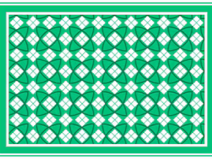

<div align="center">
  
  
  <h1>Memory Match</h1>
  <p><strong>A Feature-Rich Card Matching and Math Puzzle Game Built with Pygame</strong></p>
  
  <p align="center">
    
    
    
  </p>
  
  <p align="center">
    A desktop memory game featuring multiple board dimensions, customizable image themes, procedural arithmetic puzzle modes, user profile management, audio controls, and persistent leaderboard tracking.
  </p>
</div>

## Tech Stack


## Overview

Memory Match is an interactive desktop game built in Python using Pygame. Players flip cards to identify matching pairs against the clock while minimizing total moves. In addition to classic image-matching modes, the project introduces a Nightmare Mode where players match equivalent mathematical expressions generated on the fly.

Player progress, completion times, and star ratings are recorded across sessions using local CSV storage, allowing multiple registered users to compete for top positions on the in-game leaderboard.

## Key Features

- Dual Game Modes: Choose between classic visual card matching and arithmetic-based Nightmare Mode.
- Dynamic Board Dimensions: Supports 4x4 (Easy, 8 pairs), 4x6 (Medium, 12 pairs), and 6x6 (Hard, 18 pairs) layouts.
- Six Visual Themes: Easy, Medium, and Hard tiers support thematic card decks including Animals, Disney Characters, Dresses, Emojis, Football Clubs, and Flowers.
- Procedural Math Engine: Nightmare Mode generates distinct arithmetic expressions across addition, subtraction, multiplication, and division that evaluate to identical integer answers.
- Animated Card Flips: Cards feature smooth horizontal scaling animations to simulate perspective-aware card flips.
- Player Profiles: Built-in user authentication supporting account creation and login stored locally.
- Leaderboard System: Top ten completion records ranked by star rating, total elapsed time, and move efficiency, with category filters.
- Audio Controls: Dedicated background soundtrack per theme, customized sound effects (card flip, match confirmation, victory chime), master volume sliders, and mute toggles.
- Pause and In-Game Navigation: Overlay menu accessible during active play to resume, restart, adjust sound settings, or exit to the main menu.

## Scoring and Evaluation

Performance is evaluated upon matching all card pairs based on elapsed time and move efficiency.

### Star Rating Model

Stars are awarded based on predefined time thresholds specific to each difficulty mode:

$$
\text{Stars} = \begin{cases} 3, & \text{if } t \le T_3 \\ 2, & \text{if } T_3 < t \le T_2 \\ 1, & \text{if } T_2 < t \le T_1 \\ 0, & \text{if } t > T_1 \end{cases}
$$

where $t$ represents elapsed play time in seconds, and $T_1$, $T_2$, $T_3$ denote the mode threshold limits:

- Easy Mode (4x4): $T_3 = 20\text{s}$, $T_2 = 40\text{s}$, $T_1 = 60\text{s}$
- Medium Mode (4x6): $T_3 = 35\text{s}$, $T_2 = 70\text{s}$, $T_1 = 100\text{s}$
- Hard Mode (6x6): $T_3 = 50\text{s}$, $T_2 = 90\text{s}$, $T_1 = 120\text{s}$
- Nightmare Mode (4x4): $T_3 = 20\text{s}$, $T_2 = 40\text{s}$, $T_1 = 60\text{s}$

### Nightmare Math Logic

In Nightmare Mode, matching pairs share the same integer target $y \in [2, 50]$. The card generator constructs two distinct arithmetic expressions $e_1$ and $e_2$ such that:

$$
\text{eval}(e_1) = \text{eval}(e_2) = y \quad \text{where} \quad e_i \in \{a + b, a - b, a \times b, a \div b\}
$$

## Project Structure

```
Memory-Match/
├── assets/
│   ├── audio/
│   │   ├── music/               # Background tracks for menu, nightmare, and themes
│   │   └── sfx/                 # Sound effects (card_flip, card_match, win)
│   └── images/
│       ├── backgrounds/         # High-resolution menu, level, and mode backgrounds
│       └── cards/               # Card face graphics organized by theme collection
│           ├── animals/         # Animal theme deck (18 cards)
│           ├── disney/          # Disney character theme deck (18 cards)
│           ├── dresses/         # Fashion dresses theme deck (8 cards)
│           ├── emoji/           # Emoji theme deck (18 cards)
│           ├── fc_teams/        # Football club crests theme deck (18 cards)
│           ├── flowers/         # Floral theme deck (8 cards)
│           └── shared/          # Default card back graphic
├── data/
│   ├── score.csv                # Persistent game records (timestamp, user, mode, time, moves, stars)
│   └── users.csv                # Registered user accounts
├── main.py                      # Primary application entrypoint and UI loop
├── nightmare_mode.py            # Math expression engine and Nightmare board logic
├── requirements.txt             # Python package dependencies
└── .gitignore                   # Ignore rules for cache, environments, and artifacts
```

## Architecture and Execution Flow

1. Initialization: Pygame display and audio mixer initialize at 800x600 resolution at 60 FPS. Data storage directories and CSV headers are validated.
2. User Authentication: Player enters username via login screen; new players can register directly, storing account creation timestamps in `data/users.csv`.
3. Game Setup: Player selects game mode and theme. The board constructs randomized card positions and pairs, while the audio controller streams theme-specific background music.
4. Gameplay Loop: Events capture card clicks, flip animations run, and turn comparisons check matching card identifiers. Matched cards stay visible; mismatched cards flip face down after a brief delay.
5. Victory and Scoring: When all cards match, game timers halt, star calculations execute, victory sound triggers, and results save to `data/score.csv`.
6. Leaderboard Display: Historical scores are queried and sorted by stars descending, time ascending, and moves ascending.

## Installation and Setup

### Prerequisites

- Python 3.8 or higher
- Git

### Setup Steps

1. Clone the repository:

```bash
git clone https://github.com/rava-andika/Memory-Match.git
cd Memory-Match
```

2. Create and activate a virtual environment:

On Linux or macOS:
```bash
python3 -m venv .venv
source .venv/bin/activate
```

On Windows:
```powershell
python -m venv .venv
.venv\Scripts\Activate.ps1
```

3. Install required dependencies:

```bash
pip install -r requirements.txt
```

4. Launch the game:

```bash
python main.py
```

## Controls

- Left Mouse Button: Select menu items, flip cards, drag volume sliders, and interact with pause menu buttons.
- ESC: Toggle the in-game pause menu.
- R: Quick restart after completing a game.
- M: Return to the main menu after completing a game.
